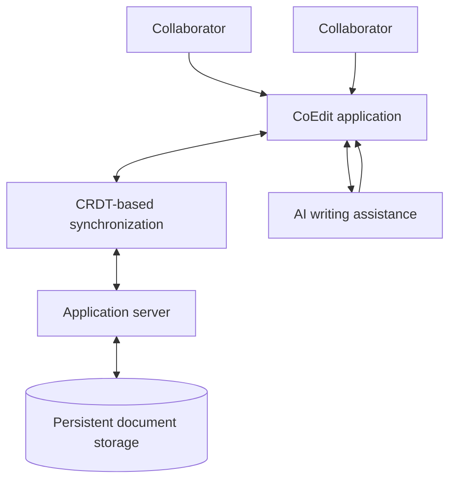

# CoEdit

**Write together. Stay in sync. Make every document better.**

CoEdit is an AI-assisted, real-time collaborative document editor. It brings rich-text editing, CRDT-based synchronization, persistent document storage, and intelligent writing assistance into one collaborative writing experience.

The goal is simple: make it easier for people to create, refine, and work on documents together—without losing the flow of writing.

---

## Contents

- [Overview](#overview)
- [Key capabilities](#key-capabilities)
- [How CoEdit works](#how-coedit-works)
- [Repository structure](#repository-structure)
- [Technology and implementation](#technology-and-implementation)
- [Getting started](#getting-started)
- [Configuration](#configuration)
- [Development workflow](#development-workflow)
- [Testing](#testing)
- [Production considerations](#production-considerations)
- [Contributing](#contributing)
- [Security](#security)
- [License](#license)

## Overview

Traditional document workflows can make collaboration feel fragmented: people work in separate copies, changes arrive at different times, and combining edits becomes a task of its own. CoEdit is designed around a shared editing experience.

It combines four central capabilities:

1. **Rich-text editing** for creating structured, readable documents.
2. **Real-time collaboration** so multiple contributors can work on a document together.
3. **CRDT-based synchronization** to support consistent document state when edits happen concurrently.
4. **AI-assisted writing** to bring intelligent assistance into the writing workflow.

Documents are backed by persistent storage, making CoEdit more than a temporary shared editing session.

## Key capabilities

### Rich-text document editing

Create and refine documents in a rich-text editing environment. The editor is intended to support a more expressive writing experience than a plain text field.

### Real-time collaboration

CoEdit is built for collaborative editing. Contributors can work on shared document content while changes are synchronized across the application.

### CRDT-based synchronization

CoEdit uses a **Conflict-free Replicated Data Type (CRDT)** approach for document synchronization. CRDTs are designed to reconcile concurrent updates through well-defined data structures and merge rules, helping replicas converge on a consistent state without relying on a simple last-write-wins replacement of the entire document.

This approach is particularly relevant to collaborative editors, where more than one person may update content at the same time.

### Persistent document storage

Document data is stored persistently by the application. This provides a foundation for retaining work beyond an individual editing session.

### Intelligent writing assistance

AI-assisted writing capabilities complement the editor and help make the document-creation workflow more productive. The specific AI provider, model, and available actions are implementation-dependent and should be configured through the project's own server-side settings.

## How CoEdit works

At a product level, CoEdit brings the editor, collaboration synchronization, document storage, and writing assistance together. The following diagram is a conceptual overview of those responsibilities, not a protocol-level architecture specification.



The central design idea is to keep the writing experience unified: people edit documents in the application, collaborative changes are synchronized using CRDT-based mechanisms, documents are persisted, and AI assistance is available as part of the product experience.

## Repository structure

The repository is organised into separate application and server directories:

```text
coedit/
├── app/          # Application / client-side code
├── app-server/   # Server-side application code
├── .gitignore    # Local environment and build-artifact exclusions
└── README.md     # Project documentation
```

The repository's ignore rules cover Python environments and artifacts, SQLite database files, Node dependencies, Vite build output, and Django-related static/test artifacts. For exact framework versions, dependency lists, and executable scripts, use the manifests and configuration files in the relevant application directory.

## Technology and implementation

The project description identifies the following core implementation capabilities:

| Area | Project capability |
|---|---|
| Application | Collaborative document-editing experience |
| Editing | Rich-text document editing |
| Synchronization | CRDT-based collaboration |
| Persistence | Persistent document storage |
| Writing support | AI-assisted writing |

At the repository level, `app/` contains the application code and `app-server/` contains server-side code. The checked-in ignore rules indicate a Python development environment and a Node/Vite frontend build environment. Specific framework names, package versions, database engines, AI vendors, and network protocols are intentionally not assumed here because they should be documented from the actual dependency manifests and source configuration.

## Getting started

### Prerequisites

Before setting up CoEdit, make sure the development environment includes:

- **Git** to clone and manage the repository.
- **Python** for the Python-side development environment.
- **Node.js** and the package manager specified by the frontend lockfile for the application build tooling.
- A compatible database and any external services required by the server configuration.

Use the versions declared by the project's runtime configuration and dependency manifests. Do not assume that the newest available runtime is compatible with the project.

### 1. Clone the repository

```bash
git clone https://github.com/VarunB453/coedit.git
cd coedit
```

### 2. Set up the server

The server-side project is located in `app-server/`. A Python virtual environment keeps project dependencies isolated from the system installation.

```bash
cd app-server
python -m venv .venv
```

Activate the environment:

```bash
# macOS / Linux
source .venv/bin/activate

# Windows PowerShell
.venv\Scripts\Activate.ps1
```

Install dependencies using the manifest present in `app-server/`. For example, when the directory contains a `requirements.txt` file:

```bash
python -m pip install -r requirements.txt
```

If the server uses a `pyproject.toml` or another dependency manager instead, follow the commands declared by that project configuration.

Apply database migrations and start the development server using the commands provided by the server framework. For a Django project, these commonly take the following form:

```bash
python manage.py migrate
python manage.py runserver
```

Run these Django commands only when the server directory contains the corresponding Django project entry point (`manage.py`).

### 3. Set up the application

The client-side application is located in `app/`. Check the package manifest and lockfile to identify the package manager and supported scripts.

When `app/` contains a `package.json` and an npm lockfile, a typical setup is:

```bash
cd ../app
npm install
npm run
```

`npm run` lists the scripts available in the project. Start the development application with the script declared in `package.json` (often `npm run dev` in Vite-based projects):

```bash
npm run dev
```

If the frontend package is nested inside `app/`, run these commands from that package directory instead. If the repository uses pnpm, Yarn, or another package manager, use the matching lockfile and package-manager commands.

### 4. Open CoEdit

Once the server and application are running, open the local URL printed by the frontend development server. Use the server URL and any required API configuration printed or documented by the backend setup.

> **Setup note:** The public repository metadata available for this documentation pass did not expose the dependency manifests or source-level run scripts. The commands above are therefore conditional examples, not a claim that every command or file exists at the stated path. The package manifests and server entry point should be treated as the source of truth for the exact local setup.

## Configuration

CoEdit's server-side settings may depend on the local development environment and any connected services. Before starting the application:

1. Review the configuration files in `app-server/` and `app/`.
2. Check for tracked example environment files such as `.env.example`.
3. Create local environment files only where the project expects them.
4. Supply credentials and service URLs through environment variables or the configuration mechanism used by the project.
5. Keep real credentials out of source control.

The repository's `.gitignore` excludes `.env` and `.env.*` files while allowing `.env.example`, which is a useful convention for documenting required settings without committing secrets. The exact variable names and required values should be taken from the checked-in example file and application settings; they are not guessed in this README.

## Development workflow

A practical development workflow is to keep the application and server running in separate terminal sessions.

- Make interface and editor changes in `app/`.
- Make API, persistence, synchronization, and server-side writing-assistance changes in `app-server/`, wherever those responsibilities are implemented.
- Keep shared data contracts and document behavior consistent between the application and server.
- Validate concurrent editing with more than one browser session when changing collaboration-related code.
- Avoid committing generated output, local databases, virtual environments, dependency directories, or secrets.

When changing CRDT-related behavior, pay particular attention to concurrent inserts, deletes, overlapping updates, reconnect behavior, and consistency between collaborators. These are important classes of scenarios for any replicated collaborative editor.

## Testing

Run the test commands defined by the project configuration and package scripts. The repository ignore rules include Python test and coverage artifacts, so a Python test workflow may be part of the server-side development process.

Useful areas to cover include:

- Rich-text editing and document state updates.
- Concurrent edits from multiple collaborators.
- CRDT merge and convergence behavior.
- Saving, retrieving, and updating persisted documents.
- Server/API error handling and invalid input.
- AI writing-assistance integration, including service failures and missing configuration.

Use the actual test runner and scripts declared by the repository. For example, `pytest` is appropriate only if pytest is installed and configured for the server project; frontend test commands should be taken from the frontend's `package.json` scripts.

## Production considerations

Before deploying CoEdit for real users, review the following areas in the implementation and deployment environment:

- **Secrets and configuration:** keep API keys, database credentials, and other secrets in a secure server-side configuration store.
- **Transport security:** use HTTPS and secure real-time communication endpoints in production.
- **Data durability:** configure database backups and test document restoration.
- **Authorization:** ensure users can access only documents and collaboration sessions they are permitted to use.
- **AI service handling:** validate inputs, handle provider timeouts and errors, and avoid exposing private credentials to the browser.
- **Operational visibility:** configure application logs, health checks, and monitoring appropriate to the deployment.
- **Scaling:** evaluate the persistence and synchronization design under the expected number of concurrent documents and collaborators.

These are deployment recommendations, not claims that a particular authentication, hosting, monitoring, or scaling implementation is already included.

## Contributing

Contributions that improve the editor, collaboration reliability, document persistence, AI-assisted writing, testing, and documentation are welcome.

A useful contribution process is:

1. Fork the repository and create a focused branch.
2. Keep changes scoped to a clear issue or improvement.
3. Follow the conventions and tooling already used in the relevant directory.
4. Add or update tests when changing application behavior.
5. Run the applicable checks before opening a pull request.
6. Describe the motivation, implementation, and verification steps in the pull request.

For substantial changes, open an issue first to discuss the proposed direction and avoid duplicating work.

## Security

Please do not report security vulnerabilities in public issues. Use the repository owner's preferred private reporting channel, if one is configured. Until a dedicated security policy is published, avoid sharing exploit details or credentials publicly.

Never commit passwords, access tokens, private API keys, production database exports, or real user documents.

## License

A license was not identifiable from the repository information reviewed for this README. Until a `LICENSE` file is added, the project's reuse, modification, and redistribution terms should be treated as **unspecified**. Add the intended license before inviting external reuse or distribution.

---

<p align="center">
  <strong>CoEdit — better documents, built together.</strong>
  <br />
  <a href="https://github.com/VarunB453/coedit">Explore the repository</a>
</p>
